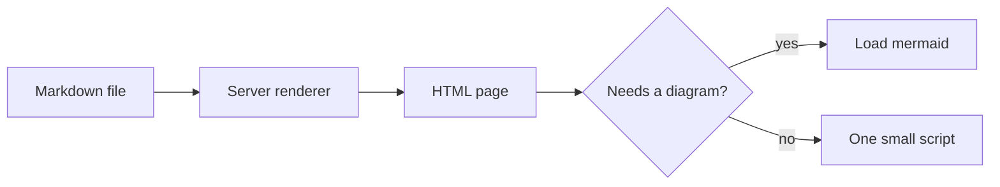

# The prose page

This page shows what the renderer does with one Markdown file. It is a showcase,
not a guide.

A paragraph with **bold text**, *italic text*, `inline code` and a
[link to the notes](notes.md). The link is underlined, so it does not depend on
colour alone.

## Headings

Three levels are enough for a page this size. Use sentence case.

### A third-level heading

#### A fourth-level heading

## Lists

- One item
- Another item
  - A nested item
  - A second nested item
- A third item

1. A numbered step
2. A second step
3. A third step

- [x] A finished task
- [ ] An open task

## A quote

> A blockquote reads as a quiet aside. It has no label and no colour.

## Callouts

> **Note:** The renderer keeps the label as a word, so the meaning survives
> without colour.

> **Warning:** This callout marks a risk. The label is the signal, not the
> border.

## A table

| Language | Rendered by | Notes |
| --- | --- | --- |
| Markdown | `pulldown-cmark` | Footnotes and tables are on. |
| Rust | `syntect` | Highlighted on the server. |
| Notebook | this project | Cells, output and images. |

## Code

The server highlights a fence when it knows the language.

```rust
fn main() {
    let text = "reposerve";
    println!("{} has {} characters", text, text.len());
}
```

```python
from pathlib import Path

for path in sorted(Path(".").glob("*.md")):
    print(f"{path.name}: {path.stat().st_size} bytes")
```

```sql
select name, size
from files
where size > 1024
order by size desc;
```

A fence without a language stays plain.

```text
Serving 12 files from ./showcase
  http://192.168.1.20:8095/
```

## Math

Inline math sits in a sentence, like $E = mc^2$, and the spacing matches the
line. Display math gets its own block:

$$
\int_0^1 x^2 \, dx = \frac{1}{3}
$$

## A diagram

A diagram is text until the browser draws it. The browser loads the diagram
script only on a page like this one.



## An image

Images come from the repository, so a relative path works.


## A heading with an explicit identifier {#kept}

The identifier above is kept as written. Link to it with `#kept`.

## Footnotes

A sentence with a footnote.[^1] The note sits at the end of the page.

[^1]: The footnote text, with its own `code`.

## A short section

That is the whole page. Open `notes.md` to see the previous and next links work.
